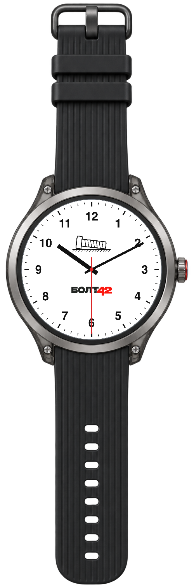
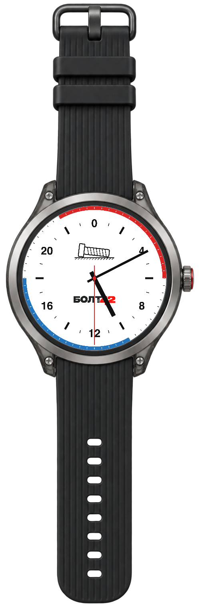
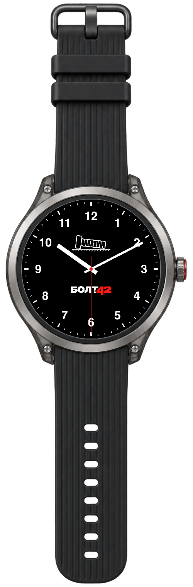
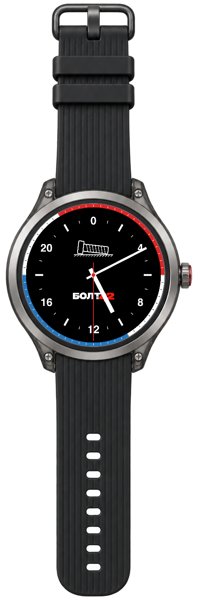
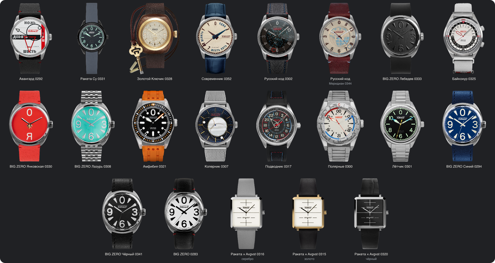

# Vremya — desktop clock for macOS

[Русский](README.md) · [English](README.en.md)

**Время (Vremya) 2.7.1** is a desktop clock app with an always-on-top mode. It includes 36 themes: four Minimalism variants, 21 Raketa models, and 11 variants in Legendary models. The app displays your Mac's local time, works offline, and remembers your settings.

**[Download Vremya for macOS](https://github.com/lesa80/time/releases/download/v2.7.1/Vremya-2.7.1-macOS-universal.zip)** · [All releases](https://github.com/lesa80/time/releases) · [SHA-256](https://github.com/lesa80/time/releases/download/v2.7.1/SHA256SUMS)

Requires **macOS 13 or later**. One universal archive for Apple Silicon and Intel. The current release is a test build with an ad-hoc signature and no Apple notarization. [Compatibility details](docs/RELEASE_NOTES.md) (in Russian).

| Minimalism | Minimalism 24 | Minimalism — Dark | Minimalism 24 — Dark |
|:---:|:---:|:---:|:---:|
|  |  |  |  |

## Features

- Russian, English, German, French, and Spanish interface.
- 12- and 24-hour dials, light and dark designs, and counterclockwise hands on supported models.
- Dial-only mode or a complete watch with bezel and strap.
- Drag to reposition, keep the clock above other windows, or lock its position and let clicks pass through.
- Five sizes: 180, 240, 280, 360, and 466 points.
- Smooth seconds hand with an option to hide it.
- Speedmaster chronograph with start, pause, resume, and reset using case pushers or the Interaction menu.
- G-Shock alarm, countdown with auto-repeat, stopwatch with splits, backlight, and case-button controls.
- Short G-Shock button beeps with an option to turn them off.
- Haptic feedback when hovering over watch pushers: three patterns or fully disabled.
- Launch at login.
- Theme, size, position, and display settings saved between launches.
- Help, the watch collection, and project information in the About window.

The default theme is **Minimalism 24 — Dark**. All four Minimalism variants appear in the main theme list. Manufacturer models are under **Theme → Raketa** and **Theme → Legendary models**.

## Manufacturer models

Rolex, Omega, Cartier, Audemars Piguet, and Casio are under **Theme → Legendary models**. Raketa models are under **Theme → Raketa**. Official manufacturer and model links are listed below; feature descriptions refer to the app.

### Rolex Submariner / Submariner Date

[Rolex website](https://www.rolex.com/) · [Submariner collection](https://www.rolex.com/watches/submariner/all-models)

Seven case, bracelet, and color configurations. Date variants display the current date from your Mac's local calendar.

| Model | Configuration |
|---|---|
| [124060](https://www.rolex.com/watches/submariner/m124060-0001) | Black, steel, no date |
| [126610LN](https://www.rolex.com/watches/submariner/m126610ln-0001) | Black, steel, date |
| [126610LV](https://www.rolex.com/watches/submariner/m126610lv-0002) | Green bezel, black dial, steel, date |
| [126613LB](https://www.rolex.com/watches/submariner/m126613lb-0002) | Blue, steel and yellow gold, date |
| [126613LN](https://www.rolex.com/watches/submariner/m126613ln-0002) | Black, steel and yellow gold, date |
| [126618LN](https://www.rolex.com/watches/submariner/m126618ln-0002) | Black, yellow gold, date |
| [126618LB](https://www.rolex.com/watches/submariner/m126618lb-0002) | Blue, yellow gold, date |

### Omega Speedmaster Moonwatch

[Omega website](https://www.omegawatches.com/) · [Model 310.30.42.50.01.001](https://www.omegawatches.com.hk/en-hk/watch-omega-speedmaster-moonwatch-professional-co-axial-master-chronometer-chronograph-42-mm-31030425001001)

The small left hand shows running seconds. The central chronograph hand and 30-minute and 12-hour counters measure elapsed time. The upper case pusher starts, pauses, and resumes; the lower pusher stops and resets. The same actions appear under **Interaction** immediately below the model name, including in dial-only mode. Elapsed time continues across theme changes and Mac sleep, but resets when the app quits.

### Cartier Tank Must

[Cartier website](https://www.cartier.com/) · [Tank collection](https://www.cartier.com/en-us/watches/collections/tank/) · [Official WSTA0041 user guide](https://www.userguide.cartier.com/WSTA0041.html)

Rectangular dial, two blue hands, and a black strap. This theme has no seconds hand.

### Audemars Piguet Royal Oak

[Audemars Piguet website](https://www.audemarspiguet.com/) · [Model 15510ST.OO.1320ST.06](https://www.audemarspiguet.com/en/watch-collection/royal-oak/15510ST.OO.1320ST.06)

Blue dial, three live hands, local date, and an integrated steel bracelet.

### Casio G-Shock DW-5600

[Casio website](https://www.casio.com/) · [DW-5600E-1V](https://www.casio.com/us/watches/gshock/product.DW-5600E-1V/) · [DW-5600UE-1](https://www.casio.com/europe/watches/casio/product.DW-5600UE-1/)

Four modes: **Timekeeping, Alarm, Countdown timer, and Stopwatch**.

- Local time in 12/24-hour format, seconds, weekday, month, and date, synchronized with macOS.
- Stopwatch with hundredths during the first hour, split times, and two finishes. After the first hour it shows hours, minutes, and seconds; the display wraps at 24 hours.
- Countdown from 1 second to 24 hours, with start, pause, resume, reset, and auto-repeat.
- Alarm with hour, minute, and optional month/day: daily, monthly, within a selected month, or on a selected date. An hourly signal is also available.
- Blue-green LCD backlight for two seconds and Flash Alert. With Reduce Motion enabled in macOS, flashing is disabled.

All four case buttons work: **A**, upper left, adjusts/splits/resets; **B**, upper right, starts/stops/increments; **C**, lower left, changes mode or field; **D**, lower right, illuminates the screen or changes the time format/auto-repeat while editing. Hold B for two seconds in Timekeeping to toggle Flash Alert.

Use **Interaction → Mode** to select a function directly and **G-Shock settings** to configure the alarm and countdown. The menu also works without the case. Settings persist between launches; elapsed timers last until the app quits and continue across theme changes and Mac sleep.

Button presses and mode selection in Interaction produce a short 80 ms beep. Sound is enabled by default; turn it off under **Interaction → G-Shock settings → Button sound**. The choice is saved and does not affect the alarm, countdown, or hourly signal. Hovering stays silent, a long press produces one beep, and stopping a ringing alert adds no button beep.

Sound requires the app to remain running. The app does not wake a sleeping Mac: overdue countdowns and alarms are checked after wake. Interaction offers a stop-sound command regardless of the selected theme.

[Detailed controls](docs/GSHOCK.en.md) · [Official Casio manual](https://www.casio.com/content/dam/casio/global/support/manuals/watches/pdf/32/3229/qw3229_EN.pdf)

### Raketa

[Raketa website](https://raketa.com/) · [Watch catalog](https://raketa.com/watches)

21 themes with dials, cases, and straps based on the corresponding models. The collection is a snapshot from October 18, 2026.



<details>
<summary>All Raketa models and manufacturer links</summary>

- [Avangard 0292](https://raketa.com/product/avangard-0292)
- [Raketa Su 0331](https://raketa.com/product/raketa-su)
- [Golden Key 0328](https://raketa.com/product/zolotoy-klyuchik)
- [Contemporary 0352](https://raketa.com/product/sovremennik)
- [Russian Code 0302](https://raketa.com/product/russkiy-kod-0302)
- [Russian Code Meridian 0344](https://raketa.com/product/russkiy-kod-0344)
- [BIG ZERO Lebedev 0333](https://raketa.com/product/raketa-x-lebedev)
- [Baikonur 0325](https://raketa.com/product/baykonur-0325)
- [BIG ZERO Yankovskaya 0330](https://raketa.com/product/big-zero-yankovskaya)
- [BIG ZERO Azure 0308](https://raketa.com/product/big-zero-azur-blue)
- [Amphibian 0321](https://raketa.com/product/amfibiya-0321)
- [Copernicus 0307](https://raketa.com/product/kopernik-0293)
- [Submariner 0317](https://raketa.com/product/podvodnik-0317)
- [Polar 0300](https://raketa.com/product/polyarnye-0300)
- [Pilot 0301](https://raketa.com/product/letchik)
- [BIG ZERO Blue 0294](https://raketa.com/product/big-zero-blue)
- [BIG ZERO Black 0341](https://raketa.com/product/big-zero-black-0341)
- [BIG ZERO 0283](https://raketa.com/product/big-zero-0283)
- [Raketa × Avgvst 0316 · Silver](https://raketa.com/product/raketa-avgvst-0316)
- [Raketa × Avgvst 0315 · Gold](https://raketa.com/product/raketa-avgvst)
- [Raketa × Avgvst 0320 · Black](https://raketa.com/product/raketa-avgvst-0320)

</details>

## Installation

1. [Download the ZIP](https://github.com/lesa80/time/releases/download/v2.7.1/Vremya-2.7.1-macOS-universal.zip) and extract it.
2. Move `Время.app` to Applications and open it.
3. Drag the clock to your preferred position. Right-click the clock or its menu bar icon to open settings.

If macOS blocks the test build, allow it to open in System Settings → Privacy & Security.

## Interface language

At launch, the app follows the primary macOS language: Russian, English, German, French, or Spanish. Unsupported languages fall back to English. Regional variants such as Austrian German are supported. Restart the app after changing the language in macOS.

## Controls

| Action | Result |
|---|---|
| Appearance → Bezel and strap | Switch between the dial and the full watch |
| Speedmaster pushers / Interaction | Start, pause, resume and reset the chronograph |
| G-Shock A/B/C/D buttons / Interaction | Modes, settings, stopwatch, countdown, and backlight |
| Interaction → G-Shock settings → Button sound | Enable or disable button beeps; the choice is saved |
| Haptic feedback | Disabled, Generic, Alignment, or Level change; the choice is saved |
| Drag the clock | Move it |
| Left-click the menu bar icon | Toggle always-on-top mode |
| Right-click or Control-click | Open settings |
| Lock position | Let clicks pass through the clock; settings remain accessible from the menu bar |
| Return to screen | Bring the clock back onto the screen and unlock its position |

**Appearance** groups size, bezel, and hand settings; **Window** groups always-on-top, position lock, and return to screen. Clicking the dial does not toggle the bezel. **Interaction** appears directly below the model name when actions are available.

Hovering over an enabled case pusher shows a pointing-hand cursor. A Force Touch trackpad can provide the selected feedback while your finger touches it and haptics are enabled in macOS. The system controls intensity and may suppress feedback.

To launch at login, enable **Launch at login** in the app menu. If macOS requests approval, allow it in System Settings → General → Login Items.

## Build from source

Requires macOS, Command Line Tools for Xcode with Swift 6, Node.js 22+, and npm. Run these commands in the project directory:

```sh
npm ci
npm run build
```

The app and ZIP will be placed in `dist/macos/`. [Developer instructions](CONTRIBUTING.md) (in Russian) · [GitHub Actions](https://github.com/lesa80/time/actions).

## License and credits

The code is licensed under [MIT](LICENSE). The БОЛТ42 (BOLT42) logo and app icon belong to the project author, [@lesa80](https://github.com/lesa80), who retains the rights to them. [License scope](LICENSE_SCOPE.md) · [Third-party notices](THIRD_PARTY_NOTICES.md) (in Russian).

Vremya is an independent, unofficial app. It is not affiliated with or endorsed by Rolex, Omega, Cartier, Audemars Piguet, Casio, or Raketa. Manufacturer names, designs, and logos are excluded from the project’s MIT license; the links above lead to official sources.
